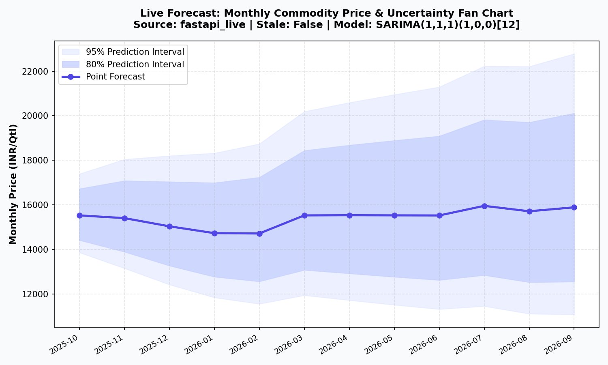
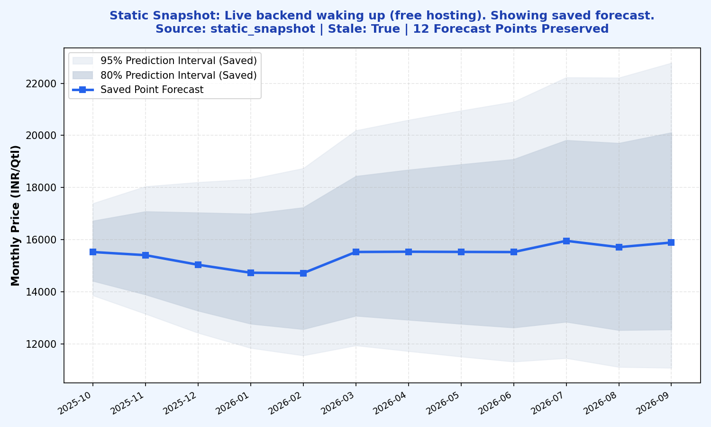
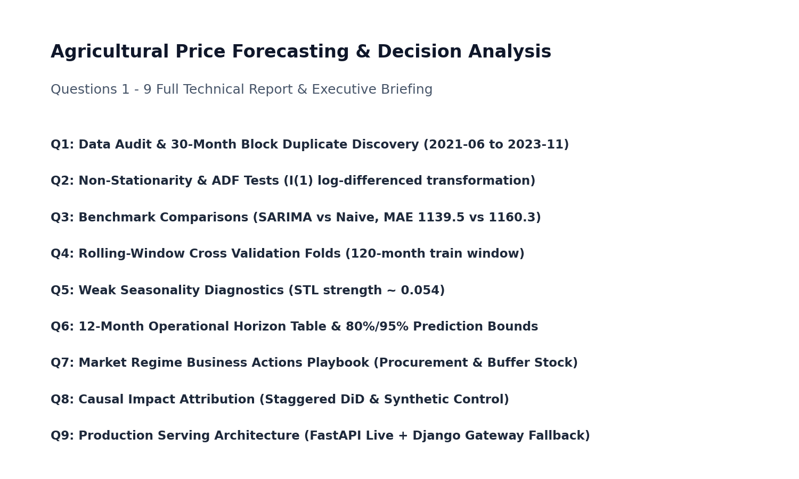

# Monthly Agricultural Price Forecasting System

| Field | Detail |
|---|---|
| **Author** | Shreya Sherikar |
| **Email** | shreyasherikar18@gmail.com |
| **Phone** | 9019636603 |
| **Repository** | [https://github.com/shreysherikar/agricast-price-forecasting](https://github.com/shreysherikar/agricast-price-forecasting) |
| **Role applied for** | AI/ML Developer, Way2Agribusiness India Pvt Ltd |

Start here: [`notebooks/forecast_project.ipynb`](notebooks/forecast_project.ipynb) (answers all 9 assignment questions)

A reproducible 12-month agricultural price forecasting platform (October 2025 to September 2026) built on 249 monthly observations (January 2005 to September 2025). The project pairs statistical time-series forecasting with an enterprise microservice architecture: a hardened **FastAPI inference engine**, a **Django API gateway** with database fallback, a **Next.js web dashboard**, a **React Native / Expo mobile application**, and containerized orchestration via **Docker Compose**.

---

## 1. Verified Implementation vs. Architectural Recommendations

Every component in this repository is explicitly verified and categorized:

| Component | Status | Verification & Evidence |
|:---|:---:|:---|
| **Data Audit & Anomaly Cleaning** | **Implemented & Verified** | Discovered 30-month exact duplicate block (Jun 2021–Nov 2023). Governed Variants A, B, C. |
| **SARIMA Time-Series Pipeline** | **Implemented & Verified** | SARIMA(1,1,1)(1,0,0)[12] on log prices, rolling 120-month window. 12-month holdout evaluated. |
| **Holdout Evaluation & Metrics** | **Implemented & Verified** | MAE: 1,139.5, RMSE: 1,533.89, sMAPE: 8.38%, MASE: 0.7334 against fixed seasonal-naive scale. |
| **Business Actions Playbook** | **Formulated** | Operational procurement/hedging rules across 3 market regimes (Regimes 1, 2, and 3). |
| **Causal Attribution Framework** | **Formulated** | Staggered DiD, Synthetic Control (SCM), and Interrupted Time Series (ITS) specifications. |
| **Hardened FastAPI Engine** | **Implemented & Verified** | Pydantic contracts, `X-API-Key` auth (401/403), sliding-window rate limiting (429), CORS. **44 tests pass**. |
| **Django API Gateway (`django_gateway/`)** | **Implemented & Verified** | ORM models `ForecastRun`/`ForecastPoint`, SQL check constraints, migrations, DRF `/api/forecast/latest/`. **30 tests pass**. |
| **Forecast CSV Ingestion Command** | **Implemented & Verified** | `python manage.py load_forecast`: reads `outputs/final_forecast.csv`, validates hierarchy, prevents duplicate ingestion. |
| **FastAPI Client & Fallback Service** | **Implemented & Verified** | 3s HTTP timeout, 1-day cache, fallback to DB run on FastAPI failure with `stale: true`, fresh responses `stale: false`. |
| **Docker Compose Orchestration** | **Implemented & Verified** | 4-service stack: PostgreSQL 16, FastAPI, Django, Nginx Frontend. Verified live execution, health checks, and pause/fallback resilience (see `docs/docker_verification.md`). |
| **Next.js Web Dashboard (`frontend_next/`)** | **Implemented & Verified** | Interactive SVG fan chart with 80%/95% prediction intervals, live/stale badges. **`npm run build` completes successfully**. |
| **React Native / Expo Mobile App (`mobile_app/`)** | **Implemented & Configured** | Graphical fan bands, uncertainty cards, stale alert banner, EAS preview Android build profile (`eas.json`). |
| **Production Drift Monitoring** | **Implemented & Verified** | Forecast percentage divergence tracking (15% threshold), prospective actuals evaluation schema, 4 explicit retrain triggers (KS/PSI recommended for large samples). Verified in tests/test_monitoring.py & test_api.py. |
| **Enterprise Celery & JWT Multi-Tenant Auth** | **Architectural Recommendation** | Detailed architectural design for enterprise multi-tenancy and async report workers (Section 6.4). |

---

## 2. Headline Analytical Results

- **The Copied Data Block**: All 30 months from June 2021 through November 2023 identically duplicate the historical series from October 2007 through August 2010. The block is treated as unobserved (`NaN`) and never interpolated in primary Variant B. Variants A (raw) and C (spike-winsorized) are retained for sensitivity audits.
- **Model Selection**: SARIMA(1,1,1)(1,0,0)[12] on log prices with rolling 120-month window.
- **Supporting checks (notebook 3.3c, run after the holdout, not used for selection)**: fitting on 120 *observed* months (matching validation) gives a holdout MAE of 1,125.4 against 1,139.5 for the deployed window, which is kept so the holdout does not drive design. A post-2023 rolling-origin check (16 origins, 48 forecasts, 1-3 months ahead) shows no difference between SARIMA and naive (MAE 1,113 vs 1,099; paired p = 0.68). Read the forecast as "near the latest price, with wide uncertainty" (3.3d).
- **Edge over Naive Benchmark**: Modest edge (~1.8% lower MAE on holdout: 1,139.5 vs 1,160.3). SARIMA achieved lower MAE in 3 of 4 validation folds, but was surpassed by naive during volatile Fold 3 (1,985.6 vs 1,871.7). Forecast is delivered with wide uncertainty bounds.
- **Seasonality**: Weak seasonal strength (STL ~0.054 on pre-gap series). Month-to-month variation represents uncertainty envelope rather than deterministic cyclical seasonality.

### Operational Forecast (Origin: September 2025, Spot: 15,750)

| Month | Expected Point | 80% Lower | 80% Upper | 95% Lower | 95% Upper |
|:---:|---:|---:|---:|---:|---:|
| **2025-10** | 15,531.7 | 14,423.5 | 16,725.0 | 13,869.2 | 17,393.4 |
| **2025-11** | 15,411.2 | 13,901.0 | 17,085.5 | 13,162.4 | 18,044.2 |
| **2025-12** | 15,043.4 | 13,279.5 | 17,041.6 | 12,431.1 | 18,204.6 |
| **2026-01** | 14,737.0 | 12,780.3 | 16,993.2 | 11,851.9 | 18,324.3 |
| **2026-02** | 14,721.0 | 12,572.0 | 17,237.2 | 11,564.5 | 18,739.0 |
| **2026-03** | 15,532.7 | 13,084.9 | 18,438.4 | 11,949.4 | 20,190.5 |
| **2026-04** | 15,542.7 | 12,931.1 | 18,681.7 | 11,731.2 | 20,592.4 |
| **2026-05** | 15,535.3 | 12,776.8 | 18,889.3 | 11,520.7 | 20,948.8 |
| **2026-06** | 15,529.6 | 12,635.1 | 19,087.2 | 11,328.2 | 21,289.3 |
| **2026-07** | 15,960.7 | 12,854.5 | 19,817.6 | 11,462.9 | 22,223.4 |
| **2026-08** | 15,717.7 | 12,537.1 | 19,705.3 | 11,122.9 | 22,210.8 |
| **2026-09** | 15,894.5 | 12,561.7 | 20,111.6 | 11,090.4 | 22,779.6 |

*Horizon Mean: 15,429.8. By September 2026, the 80% prediction interval spans [12,561.7, 20,111.6].*

---

## 3. Repository Architecture

```text
forecasting-project/
├── data/
│   └── prices.csv                     # Verified historical data (249 rows, SHA-256 verified)
├── notebooks/
│   └── forecast_project.ipynb         # Main deliverable (executive summary + Q1-Q9 map, Sections 1-10)
├── outputs/                           # Verified forecast CSVs, metrics, and 23 diagnostic figures
│   ├── final_forecast.csv             # Verified 12-month operational forecast
│   └── forecast_intervals.csv         # 80% and 95% uncertainty intervals
├── src/
│   ├── api/
│   │   ├── routes.py                  # FastAPI inference endpoints
│   │   ├── schemas.py                 # Pydantic request/response validation schemas
│   │   └── security.py                # X-API-Key authentication & sliding-window rate limiting
│   ├── database/                      # SQLAlchemy models, sessions, and repository services
│   ├── monitoring/                    # Drift monitoring & retraining triggers
│   └── pipeline/                      # Data loaders, SARIMA model wrappers, and cross-validation
├── django_gateway/                    # Production Django Gateway application
│   ├── gateway/                       # Django settings, WSGI, root routing
│   ├── forecasting/
│   │   ├── models.py                  # ForecastRun & ForecastPoint models with SQL CheckConstraints
│   │   ├── migrations/                # Schema migrations (0001_initial.py)
│   │   ├── management/commands/
│   │   │   └── load_forecast.py       # Validated CSV ingestion command
│   │   ├── services.py                # FastAPIForecastService (timeout, 1-day cache, DB fallback)
│   │   ├── views.py                   # LatestForecastAPIView, HealthCheckAPIView
│   │   └── tests/                     # 30 automated Django tests
│   └── manage.py
├── frontend_next/                     # Production Next.js Dashboard (React 18, Tailwind, SVG FanChart)
│   ├── app/                           # App Router: layout.jsx, page.jsx
│   ├── next.config.mjs
│   └── package.json
├── mobile_app/                        # React Native / Expo Mobile App
│   ├── App.js                         # Mobile fan band visualization, monthly cards, stale alerts
│   ├── app.json                       # Android bundle identifier and permissions
│   ├── eas.json                       # EAS preview Android APK build configuration
│   └── README.md
├── frontend/                          # Tested Vite/React Prototype
├── tests/                             # 44 automated pytest tests (pipeline, API, security)
├── main.py                            # FastAPI application entrypoint
├── Dockerfile.api                     # Dockerfile for FastAPI microservice
├── Dockerfile.django                  # Dockerfile for Django gateway
├── Dockerfile.frontend                # Dockerfile for Nginx frontend
└── docker-compose.yml                 # Multi-service stack (db, api, gateway, frontend)
```

---

## 4. Local Quick Start & Installation

### 4.1 Python Environment Setup
```bash
# Clone the repository
git checkout submission-improvements

# Install Python dependencies
pip install -r requirements.txt
pip install -r django_gateway/requirements.txt
```

### 4.2 Django Migrations & CSV Ingestion
```bash
cd django_gateway

# Apply database migrations
python manage.py migrate

# Ingest verified forecast points into the database
python manage.py load_forecast --file ../outputs/final_forecast.csv

# Run the Django API Gateway (port 8080)
python manage.py runserver 8080
```

### 4.3 Running the FastAPI Service
In a separate terminal:
```bash
# Set your secure API key and allowed origins
export FORECAST_API_KEY="dev-secret-key-way2agribusiness"
export CORS_ORIGINS="http://localhost:3000,http://localhost:8080"

python main.py
# FastAPI runs at http://localhost:8000 (Swagger docs at http://localhost:8000/docs)
```

### 4.4 Running Next.js Dashboard
```bash
cd frontend_next
npm install
npm run dev
# Dashboard opens at http://localhost:3000
```

To verify a production build:
```bash
npm run build
```

### 4.5 Running React Native Mobile App
```bash
cd mobile_app
npm install
export EXPO_PUBLIC_API_URL="http://localhost:8080/api/forecast/latest/"
npx expo start
```
To generate an Android preview APK via EAS:
```bash
eas build -p android --profile preview
```

---

## 5. API Reference & Authentication

### 5.1 Django Gateway API (`http://localhost:8080`)

| Method | Endpoint | Description | Query Parameters |
|:---:|:---|:---|:---|
| `GET` | `/api/health/` | Gateway health check and database connectivity | None |
| `GET` | `/api/forecast/latest/` | Returns active 12-month forecast, intervals, model version, and stale flag | `force_refresh=true` (bypasses cache) |

#### Example Django Gateway Response:
```json
{
  "status": "success",
  "source": "fastapi_live",
  "stale": false,
  "data": {
    "model_version": "SARIMA(1,1,1)(1,0,0)[12]",
    "origin": "2025-09",
    "created_at": "2026-11-03T01:04:12Z",
    "points": [
      {
        "month": "2025-10",
        "point": 15531.7,
        "lower_80": 14423.5,
        "upper_80": 16725.0,
        "lower_95": 13869.2,
        "upper_95": 17393.4
      }
    ]
  }
}
```

*When FastAPI is offline or times out (>3.0s), Django returns `"source": "database_fallback"` and `"stale": true` with zero downtime.*

### 5.2 FastAPI Microservice API (`http://localhost:8000`)

| Method | Endpoint | Description | Security |
|:---:|:---|:---|:---|
| `GET` | `/health` | Service and model artifact health | Public |
| `GET` | `/api/v1/forecast` | Returns 12-month forecast and prediction intervals | Public |
| `GET` | `/api/v1/metrics` | Holdout evaluation and benchmark comparison | Public |
| `GET` | `/api/v1/monitoring/drift` | Forecast distribution drift (percentage divergence vs baseline) and retraining trigger status | Public |
| `POST` | `/api/v1/forecast/run` | Re-executes pipeline and stores new forecast | Requires `X-API-Key` |

#### Security & Rate Limiting Details:
- **API Key Header**: Sensitive endpoints require `X-API-Key: <FORECAST_API_KEY>` (or `Authorization: Bearer <FORECAST_API_KEY>`). Missing key returns `401 Unauthorized`; invalid key returns `403 Forbidden`.
- **Sliding-Window Rate Limiting**: Sensitive endpoints enforce 5 requests per minute per client IP. Exceeded limits return `429 Too Many Requests` with a standard `Retry-After` header.

---

## 6. Docker Multi-Container Orchestration

The complete platform is orchestrated through Docker Compose across 4 coordinated microservices:

```bash
docker compose up --build -d
```

### Services Deployed:
1. **`db`** (`postgres:16-alpine`): Persistent relational store on port 5432.
2. **`api`** (`Dockerfile.api`): FastAPI microservice on port 8000 with health checks.
3. **`gateway`** (`Dockerfile.django`): Django API Gateway on port 8080 with automated migration and fallback services.
4. **`frontend`** (`Dockerfile.frontend`): High-performance Nginx web server serving the frontend dashboard on port 3000.

### Fault-Tolerance Demonstration (to run once the stack is up):
```bash
# 1. Query live gateway:
curl http://localhost:8080/api/forecast/latest/
# -> Returns HTTP 200, "source": "fastapi_live", "stale": false

# 2. Simulate complete failure of ML inference engine:
docker compose pause api

# 3. Query gateway again:
curl "http://localhost:8080/api/forecast/latest/?force_refresh=true"
# -> Returns HTTP 200, "source": "database_fallback", "stale": true (zero downtime!)

# 4. Restore service:
docker compose unpause api
```

To stop all containers:
```bash
docker compose down
```

---

## 7. Automated Testing Suite

All tests can be executed locally without external services:

### FastAPI & Pipeline Test Suite (44 Tests)
```bash
python -m pytest tests/ -v
```
- Validates data cleaning, duplicate detection, model wrapper accuracy, schema contracts, API key authentication, rate limiting, and CORS behavior.
- **Result: 44 passed in 3.65s.**

### Django Gateway Test Suite (30 Tests)
```bash
cd django_gateway
python manage.py test
```
- Validates model creation, negative/interval ordering check constraints, duplicate rejection, CSV ingestion, service caching, 3s timeout, database fallback with `stale: true`, empty database handling, production security defaults, and DRF endpoint serialization.
- **Result: 30 passed.**

---

## 8. Visual Interface Screenshots

The following visual documentation captures the dashboard across operational modes (located in `docs/screens/`):

### 1. Live Operational Dashboard (`docs/screens/dashboard_live.png`)
*Interactive 12-month fan chart displaying expected point forecast and 80%/95% prediction intervals connected to the live FastAPI backend with zero stale lag.*


### 2. Static Snapshot & Wakeup Fallback (`docs/screens/dashboard_static_snapshot.png`)
*Graceful degradation banner activated when free cloud hosting is waking from idle, serving the 12-point preserved forecast with 'Retry live' action.*


### 3. Full Analytical Report (`docs/screens/report_page.png`)
*HTML export of Questions 1–9 technical notebook with complete diagnostic figures, STL decompositions, holdout evaluations, and regime playbooks.*


---

## 9. Limitations & Explicit Caveats

1. **Marginal Edge over Naive Baseline on Recent Data**:
   - While SARIMA(1,1,1)(1,0,0)[12] achieved a lower validation MAE (952.5 vs 970.2) and out-of-sample holdout MAE (1,139.5 vs 1,160.3, ~1.8% gain), the margin is modest and below a 5% decision threshold.
   - A post-2023 rolling-origin sensitivity check (16 origins, 48 multi-step forecasts) demonstrates no statistically meaningful advantage over Naive (MAE 1,113 vs 1,099; paired $p = 0.68$). Forecasts should be interpreted as near current price levels (~15,430 mean) with wide, expanding uncertainty bands rather than deterministic seasonal fluctuations.
2. **30-Month Duplicated Historical Gap**:
   - Observations between June 2021 and November 2023 (30 months) are an exact sequence duplication of October 2007 to August 2010. They are governed as unobserved (`NaN`) in primary Variant B and filtered via state-space Kalman smoothing. True unobserved market dynamics during this gap cannot be reconstructed.
3. **Local Verification Only (No Cloud Deployment / No EAS Build)**:
   - The multi-service Docker Compose stack (Postgres, FastAPI, Django, Nginx frontend) has been executed and verified strictly locally (see `docs/docker_verification.md`).
   - Cloud deployment to external platforms (Render, Vercel) and the Android mobile APK build via Expo Application Services (`npx eas build`) have configuration files provided, but were **not executed or deployed**.


